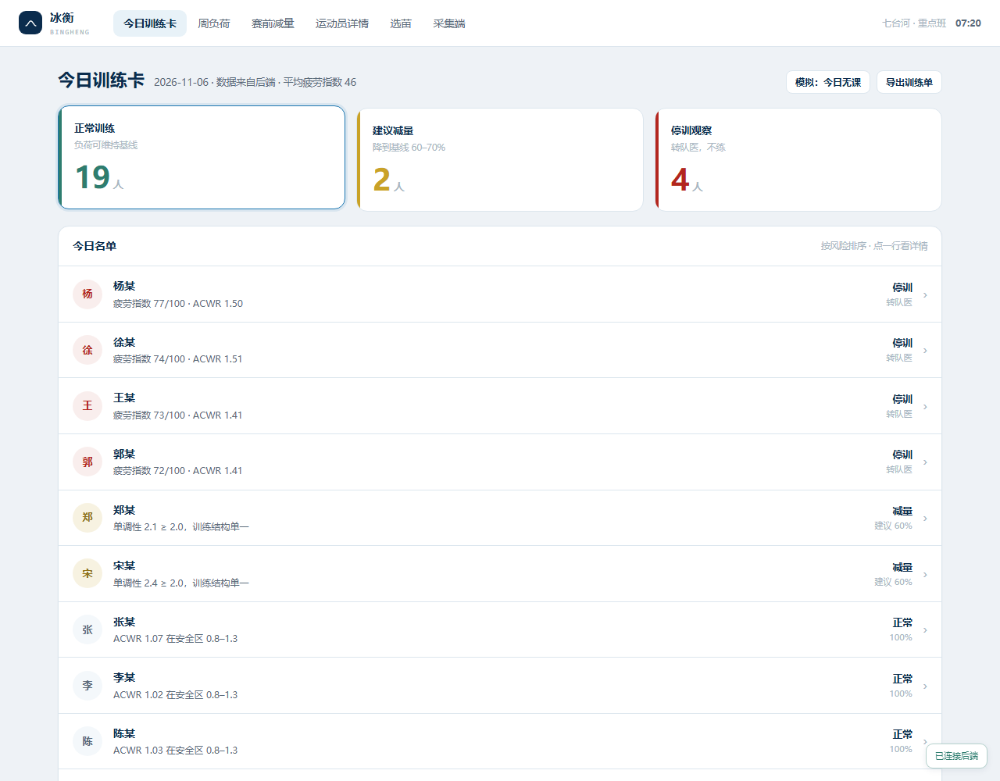
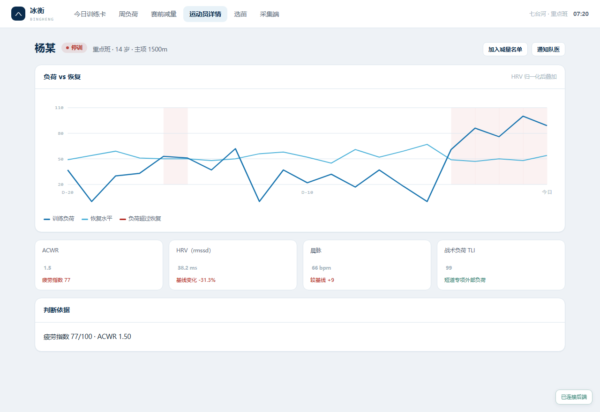

# 冰衡 · 短道速滑训练决策系统

> 把教练的「感觉」变成每天早上三张卡：今天谁该练、这周练过头没有、赛前怎么减。

一个面向青少年短道速滑队伍的**训练决策**系统。它不做数据展示，只回答一个问题：

**今天这个孩子该练多少。**



---

## 它解决什么问题

教练每天早上都要判断今天谁该减、谁可以正常练。目前这个判断几乎完全依赖经验，三个具体困难：

- **训练安排凭感觉**：缺乏统一的负荷口径，不同教练之间标准不一致。
- **疲劳看不见**：疲劳逐日累积，等到成绩下滑或出现伤病才被发现。
- **监测与决策脱节**：队里即使有心率带、纵跳测试，数据也只停在报表里，教练还要自己翻译成「这节课怎么上」。

冰衡把最后这一步补上：四项指标融合成一个 0–100 的疲劳指数，给出四档结论，并把理由写在旁边。

## 四个模块

| 模块 | 回答的问题 |
|---|---|
| 今日训练卡 | 今天谁该练、谁该减 |
| 周负荷 | 这周是不是练过头了 |
| 赛前减量 | 还有十天，怎么减 |
| 运动员详情 | 为什么是这个队员 |



## 快速开始

### 方式一：直接打开（看界面，用内置示例数据）

双击 `index.html`。无需安装、无需联网。

### 方式二：带后端跑（用真实计算的数据）

```bash
# 1. 装依赖
python -m venv .venv
.venv\Scripts\activate          # Windows
pip install -r requirements.txt

# 2. 建库灌数据（25 名运动员 × 60 天仿真数据）
python server/seed.py

# 3. 启动
python server/app.py
```

打开 <http://127.0.0.1:8770/bingheng>　接口文档 <http://127.0.0.1:8770/docs>

### 方式三：跑测试

```bash
python server/seed.py          # 测试依赖种子数据
pytest tests/test_api.py -q    # 10 项接口契约测试
```

### 页面说明

| 路径 | 需要的文件 | 状态 |
|---|---|---|
| `/bingheng` | `index.html`（仓库根目录，已有） | 可访问 |
| `/zhixing` | `zhixing.html`（**仓库中未提供**） | 返回 404 + 提示，不会 500 |

> 本次修复：`/bingheng` 之前固定读 `bingheng.html`，而仓库只有 `index.html`，导致页面 500。
> 现在按 `bingheng.html → index.html` 顺序回退；`/zhixing` 缺文件时返回明确 404。

> 页面右下角会显示「已连接后端」或「本地演示数据」——一眼能看出当前用的是哪种数据。

## 疲劳指数怎么算

```
fi = 45·f(ACWR) + 15·f(单调性) + 25·f(疲劳状态) + 15·f(晨脉偏移)
```

四档结论：正常训练 / 建议减量 / 停训观察 / 负荷偏低。阈值 60 与 80 按队内历史分布的分位数标定，不是拍脑袋定的常数。

## 我们刻意做的两个取舍

**1. 不做单指标预警。**
ACWR（急慢性负荷比）在运动医学界有明确的方法学争议——急性负荷本身是慢性负荷的组成部分，存在数学耦合；常用的 0.8–1.3「安全区」也缺乏前瞻性验证。所以冰衡只用它作为其中一个分量，必须多指标同时异常才判红，且最终决定权留给教练。

**2. 赛前减量不回溯改写历史。**
减量是「从现在开始执行」的计划，不会改变已经发生的训练记录。系统不该给出事后诸葛亮式的结论。

## 数据与接口

| 方法 | 路径 | 说明 |
|---|---|---|
| GET | `/api/bh/today` | 今日决策卡：三档统计 + 名单 |
| GET | `/api/bh/weekly` | ACWR 曲线 + 异常名单 + 训练构成 |
| GET | `/api/bh/athlete/{id}` | 个体负荷—恢复 + 指标卡 + 判断依据 |
| POST | `/api/bh/decisions` | 教练决策留痕 |
| GET | `/api/bh/taper` | 赛前减量计划 |
| GET | `/api/bh/devices/{id}` | IMU 设备状态 |

表结构见 `server/seed.py`：`athletes` / `sessions` / `daily_metrics` / `decisions` / `events` / `taper_plans` / `devices`。

**换真实数据只改 `server/seed.py`**，接口与前端不用动。

## 边界声明

- 本系统只做训练决策支持，**不替代队医、不做伤病诊断、不给用药建议**。
- 演示数据为仿真生成，界面上有标注。真实数据须获得监护人知情同意。
- 未成年人数据：本地存储、不出网、界面与导出材料均不含姓名明文。

## 许可

MIT
